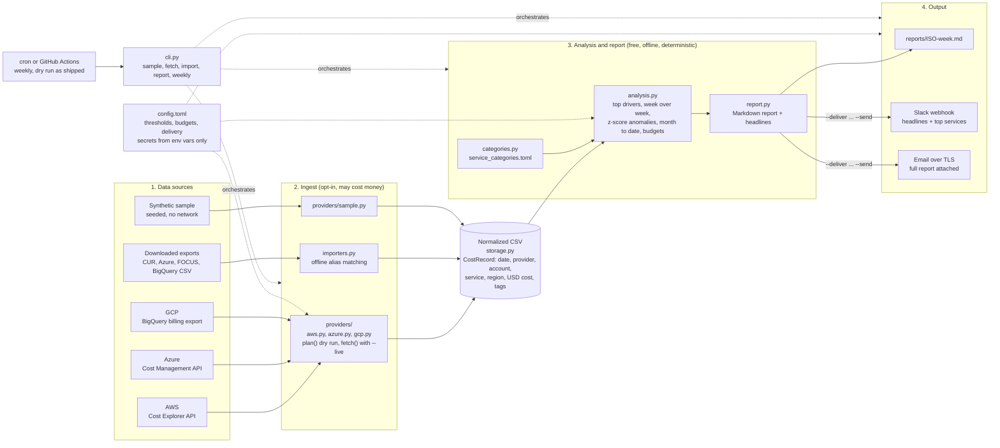
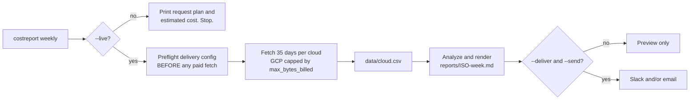

# costreport

Analyzes AWS Cost Explorer, Azure Cost Management and GCP BigQuery billing
export data, finds the top cost drivers by service and by tag, and writes a
weekly executive report in Markdown.

**Nothing here creates cloud resources, and nothing calls a cloud API unless
you pass `--live`.** Everything works offline on synthetic data. `fetch` is a
dry run unless you add `--live`, `report` only reads local files, and the cloud
SDKs are optional extras.

## Architecture

The design has one rule: **paid or networked work is separated from free
analysis by a normalized CSV.** Everything left of the CSV can cost money and is
off by default; everything right of it is pure, offline and deterministic.



### Safety gates



### Modules

| Module | Role |
| --- | --- |
| `models.py` | `CostRecord`, the single normalized row (USD only) that every stage shares |
| `providers/` | One read-only client per cloud behind a `plan()` / `fetch()` protocol; `plan()` never touches the network |
| `importers.py` | Turns console downloads into `CostRecord`s with no credentials or network |
| `storage.py` | CSV read/write, the boundary between paid fetching and free analysis |
| `analysis.py` | Pure functions over records: drivers, movers, anomalies, month to date, budgets |
| `categories.py` | Maps each cloud's service names onto shared categories (Compute, Database, ...) |
| `report.py` | Renders a `Summary` into the Markdown executive report |
| `delivery.py` | Slack and email senders with preview-by-default and injectable clients |
| `config.py` | Validated TOML settings; secrets are never read from files |
| `cli.py` | Subcommands and the `weekly` orchestration |

## Quick start (free, offline)

Requires Python 3.11+. No dependencies.

```sh
make test                 # 110 unit tests, no network
make report               # generate sample data and print a report
make example              # write a sample report to docs/example-report.md (not tracked)
```

or directly:

```sh
export PYTHONPATH=src
python3 -m costreport sample --out data/sample.csv
python3 -m costreport report --input data/sample.csv --out reports/weekly.md
```

The report opens like this (synthetic sample data):

```markdown
## Headlines

- **Total spend was $66,842**, up $3,210 (+5.0%) versus the prior 7 days ($63,632).
- Largest cost driver: **AWS · Amazon Elastic Compute Cloud - Compute** at $11,624 (17% of spend).
- Biggest increase: **GCP · BigQuery**, ▲ $2,353 (+47.9%).
- **1 anomaly flagged.** Largest: BigQuery on 2026-11-12 at $2,987 vs ~$703 typical.
- Spend with no `team` tag: 5.9% ($3,977).
- Month-to-date $138,963; naive projection to month end **$277,925**.
- **Azure is projected $6,617 over budget** ($86,617 vs $80,000).
```

Below the headlines come tables for spend by cloud, category, service and tag,
the biggest movers, anomalies, month to date, budgets and data quality.

## Real data without any API: import a download (free)

Download a cost export from your cloud console (AWS CUR / Data Export, Azure
cost export, a BigQuery result as CSV; FOCUS also works), then:

```sh
python3 -m costreport import ~/Downloads/cur.csv.gz --provider aws --out data/aws.csv
python3 -m costreport report --input data/aws.csv --config config.toml
```

`import` reads local files only and prints which columns it matched, so check
that line the first time. Aliases come from vendor docs and are not yet
verified against real exports; if a header is not recognized the error lists
what it saw and what it accepts.

## Config (optional for `report`)

`--config config.toml` adds thresholds and budgets; see `config.example.toml`.
`min_change_usd` / `min_change_pct` decide which movers are called out,
`untagged_target` sets the tagging warning, `[budgets]` adds a Budget section,
and `category_map` points at your own copy of
`src/costreport/data/service_categories.toml`.

## Delivery: Slack and email (preview by default)

Add `--deliver slack email` to `report` (or `weekly`) to send a summary. Nothing
is sent unless you also pass `--send`; without it you get a preview of exactly
what would go out.

```sh
export COSTREPORT_SLACK_WEBHOOK_URL='https://hooks.slack.com/services/...'   # secrets: env only
python3 -m costreport report --input data/aws.csv --config config.toml --deliver slack email          # preview
python3 -m costreport report --input data/aws.csv --config config.toml --deliver slack email --send   # send
```

- **Slack** gets the headlines and the top services (Slack cannot render tables).
  The webhook must be a `https://hooks.slack.com/` URL.
- **Email** gets the headlines in the body and the full Markdown report attached.
  It always uses TLS (STARTTLS, or implicit TLS on port 465). Set
  `COSTREPORT_SMTP_USER` and `COSTREPORT_SMTP_PASSWORD` if your server needs
  login. Addresses and host go in `[delivery]` in the config.
- Secrets are read from environment variables only and are never printed.
- Config is checked before anything is sent, so a bad email setting cannot
  leave Slack half-delivered.

## Scheduled weekly run

`weekly` is one command for cron or CI: fetch the last 35 days from each cloud,
save `data/<cloud>.csv`, write `reports/<ISO-week>.md`, then optionally deliver.

```sh
python3 -m costreport weekly --providers aws azure gcp                  # DRY RUN: plan only
python3 -m costreport weekly --providers aws azure gcp --live           # fetch + report + archive
python3 -m costreport weekly --providers aws azure gcp --live --deliver slack email --send
```

Without `--live` it only prints the request plan and estimated cost. The end
date defaults to 2 days ago because billing data lags. Delivery settings are
validated before any paid fetch. `--send` requires `--live`. See
`examples/crontab.example` and `examples/github-actions-weekly.example.yml`;
both are dry runs as shipped.

## Using the cloud APIs (your decision, may incur cost)

Fetching and reporting are separate steps. Fetch once to a CSV, then report on
it as often as you like for free.

```sh
cp config.example.toml config.toml        # git-ignored; fill in your scope/table
pip install '.[aws]'                      # or [azure], [gcp], [all]

# 1. Dry run (default): prints the request plan and estimated cost, sends nothing
python3 -m costreport fetch aws --start 2026-11-01 --end 2026-11-08

# 2. Live: add --live and --out
python3 -m costreport fetch aws --start 2026-11-01 --end 2026-11-08 --live --out data/aws.csv

# 3. Report across any number of clouds
python3 -m costreport report --input data/aws.csv data/azure.csv data/gcp.csv
```

Cost notes: AWS Cost Explorer charges about $0.01 per paginated API request.
GCP queries are capped by `max_bytes_billed` after a dry-run estimate. Azure
has no per-call charge. GCP needs billing export to BigQuery already enabled
(it has no backfill). Verify current pricing yourself.

The live payload shapes are written from vendor docs and have not been run
against real accounts. Start with a 1-2 day window.

## Report options

`--end-date YYYY-MM-DD` last day of the week (default: latest in data) ·
`--tag-key team` · `--top 10` · `--min-anomaly 50` · `--out FILE`
